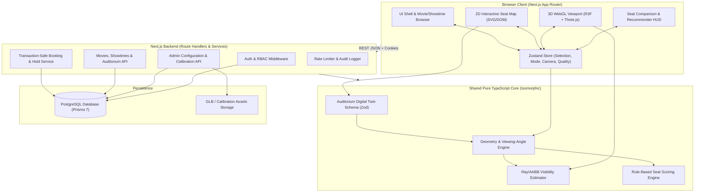
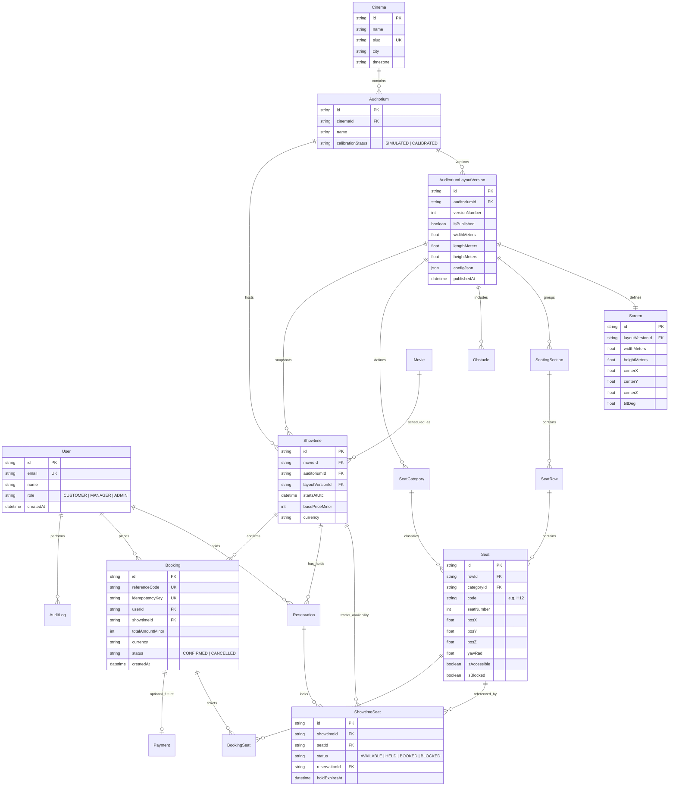

# CineView 3D — Technical Architecture & System Specification

## 1. Refined Product Specification

**CineView 3D** is an immersive cinema seat visualization and ticket booking platform. Its primary differentiator is a geometrically accurate, real-time 3D digital twin of each cinema auditorium that places prospective moviegoers at the exact seated eye position of any seat before they commit to a ticket.

### Core Product Capabilities
1. **Immersive 3D Seat Visualization (Primary Feature)**
   - Three synchronized visualization modes sharing one source of truth:
     - **2D Seat Map**: Accessible, high-contrast interactive seating chart (also serves as the automatic fallback when WebGL is unavailable).
     - **3D Theatre Overview**: Interactive orbital overview of the full auditorium, seating tiers, aisles, lighting, and screen.
     - **First-Person Seat View**: Camera placed at the physical seated eye coordinates of the chosen seat, with natural yaw/pitch head-look, configurable eye height, smooth transitions, reduced-motion support, and collision-safe movement bounds.
2. **Accurate Geometry & Viewing-Angle Engine**
   - Pure mathematical engine (meters, right-handed Y-up coordinates) calculating viewing distance, horizontal/vertical offsets, horizontal/vertical viewing angles, and actual vector-subtended angular screen coverage.
   - Multi-point geometric raycasting to estimate screen visibility and potential obstructions (seats ahead, simulated audience heads, railings, pillars, balcony overhangs).
3. **Seat Comparison & Rule-Based Recommendations**
   - Side-by-side comparison of up to 3 seats using identical camera projection settings and cached preview snapshots on lower-tier devices.
   - Transparent, configurable preference-based recommendations (Best Overall, Most Centered, Closest, Farthest, Minimal Neck Tilt, Near Aisle, Budget, Premium, Adjacent Group, Minimal Obstruction).
4. **Configuration-Driven Digital Twin & Real-World Calibration**
   - Auditoriums are generated procedurally from validated configuration schemas (with versioned layouts and optional glTF/GLB overrides).
   - Dedicated calibration metadata distinguishing `[Simulated Demo Auditorium]` from `[Measured / Calibrated Auditorium]`.
5. **Transaction-Safe Booking & Theatre Administration**
   - Movie and showtime browsing without login; authentication required only for booking confirmation, booking history, and admin workflows.
   - Atomic PostgreSQL transactions, server-authoritative temporary seat holds, idempotent booking confirmation, QR ticket generation, and role-based admin dashboard.

### Non-Functional Requirements
- **Performance**: Target 60 FPS on desktop and ≥30 FPS on mid-range mobile via instanced seat meshes, shared materials/geometries, on-demand/frameloop optimization, controlled DPR, and Low/Medium/High quality presets.
- **Accessibility**: Keyboard navigation across seats, non-color status indicators (icons/patterns/labels), `prefers-reduced-motion` support, WCAG AA contrast, and full WebGL-free 2D fallback.
- **Security**: Server-side Zod validation, RBAC enforcement on all admin endpoints, parameterized Prisma queries, CSRF/XSS protection, rate-limited reservation endpoints, and immutable admin audit logs.

---

## 2. Technical Feasibility Analysis & Stack Justification

| Layer | Selection | Justification & Compatibility (Verified Nov 2026) |
| :--- | :--- | :--- |
| **Framework** | **Next.js 16.4.x** (App Router) + **React 19.3.x** + **TypeScript (strict)** | Unified full-stack React framework with Server Components, Route Handlers, strong TypeScript support, and clean dynamic client boundaries for WebGL scenes. |
| **Styling & UI** | **Tailwind CSS 4.x** + custom accessible primitives (shadcn/ui patterns) + **Lucide React** | Zero-runtime utility CSS with dark cinematic theme tokens, accessible focus rings, and crisp iconography. |
| **State Management** | **Zustand 5.x** | Minimal-overhead reactive store synchronizing selected seats, comparison list, visualization mode, eye height, and graphics quality across 2D, 3D, and HUD panels without re-rendering the entire React tree. |
| **3D Engine** | **Three.js 0.187.x** + **@react-three/fiber 9.8.x** + **@react-three/drei 10.7.x** | R3F v9.x officially supports React 19 (`>=19 <19.4`). InstancedMesh, PBR materials, custom procedural geometry, and declarative scene graph with proper WebGL disposal. `transpilePackages: ['three']` configured in `next.config.ts`. |
| **Validation** | **Zod 4.x** | Single schema source for auditorium digital twin configs, API payloads, and booking requests. |
| **Database & ORM** | **PostgreSQL 16+** + **Prisma ORM 7.x** (pinned stable `7.10.x`, avoiding Prisma 8 RC) | Relational integrity, unique constraints on `(showtimeId, seatId)`, `SERIALIZABLE` / row-locked atomic booking transactions, and deterministic migrations. |
| **Authentication** | **Better Auth 1.x** (stable) or **Auth.js** | Chosen **Better Auth (`1.7.x`)** over `next-auth@5-beta` because Better Auth 1.x is a stable, non-beta library built natively for Next.js App Router with first-class TypeScript, RBAC support, and Prisma adapter compatibility. *(Deviation documented in `DECISIONS.md`)* |
| **Testing** | **Vitest 5.x** + **React Testing Library** + **Playwright** | Fast pure-TS unit tests for geometry/math, component integration tests, and real headless-browser E2E + WebGL canvas verification. |
| **Infrastructure** | **Docker & Docker Compose** + **GitHub Actions** | Reproducible PostgreSQL + app containers and automated lint, typecheck, test, and build CI gates. |

---

## 3. System Architecture Diagram



---

## 4. Database Entity Relationship Diagram



---

## 5. Proposed Project Folder Structure

```text
c:\Users\JoyalShaju\Projects\SeatFix\
├── .env.example
├── .github/workflows/ci.yml
├── docker-compose.yml
├── Dockerfile
├── next.config.ts
├── package.json
├── tsconfig.json
├── vitest.config.ts
├── playwright.config.ts
├── prisma/
│   ├── schema.prisma
│   ├── migrations/
│   └── seed.ts
├── docs/                          # Reference photos / diagrams if added later
├── src/
│   ├── app/                       # Next.js App Router pages & REST API routes
│   │   ├── layout.tsx
│   │   ├── page.tsx               # Main CineView 3D Showcase & Auditorium Experience
│   │   ├── movies/
│   │   ├── booking/[reference]/
│   │   ├── admin/
│   │   └── api/
│   │       ├── health/
│   │       ├── auditoriums/
│   │       ├── movies/
│   │       ├── showtimes/
│   │       ├── reservations/
│   │       ├── bookings/
│   │       └── admin/
│   ├── components/
│   │   ├── ui/                    # Reusable dark-cinematic UI primitives
│   │   ├── viewer/                # 3D Scene, CameraRig, ProceduralAuditorium, Screen, Seats
│   │   ├── seat-map/              # 2D SVG Seat Map & WebGL fallback
│   │   ├── hud/                   # Viewing metrics, Comparison tray, Recommender, Controls
│   │   └── booking/               # Movie/showtime picker & checkout flow
│   ├── lib/
│   │   ├── geometry/              # PURE TS: coordinate system, camera pose, viewing angles, obstruction
│   │   ├── auditorium/            # Zod schema, procedural layout builder, Grand Lumina preset
│   │   ├── recommendations/       # Rule-based seat scoring & explanations
│   │   ├── booking/               # Hold/booking transaction logic & validation
│   │   ├── auth/                  # Better Auth + RBAC helpers
│   │   └── db/                    # Prisma client singleton
│   ├── store/
│   │   └── useCineViewStore.ts    # Zustand store syncing 2D, 3D, camera, and comparison state
│   └── types/                     # Shared domain TypeScript interfaces
└── tests/
    ├── unit/                      # Geometry, viewing angles, obstruction, layout validation
    ├── integration/               # Component & API/booking transaction tests
    └── e2e/                       # Playwright browser & WebGL tests
```

---

## 6. Technical Risks & Mitigation Strategies

| Risk | Impact | Mitigation |
| :--- | :--- | :--- |
| **React 19 / R3F Peer Dependency Mismatches** | Build or runtime hooks errors | Verified `react@19.3.x` with `@react-three/fiber@9.8.x` and `@react-three/drei@10.7.x`, plus `transpilePackages: ['three']`. Pin exact versions in `package-lock.json`. |
| **SSR Hydration Crashes on WebGL `<Canvas>`** | Next.js server build failure | Isolate Three.js canvas behind `'use client'` and `dynamic(..., { ssr: false })`, with a clean WebGL capability check and automatic 2D seat map fallback. |
| **Low FPS on Integrated/Mobile GPUs** | Sluggish camera transitions & poor UX | Use `THREE.InstancedMesh` for repeated seat cushions/backrests/armrests, share geometries & PBR materials, disable expensive dynamic shadows in Low preset, clamp DPR (`[1, 1.75]`), and dispose GPU resources on unmount. |
| **Inconsistent Coordinates Between 2D, 3D, and Math** | Camera lands in wrong seat or angles misreport | Single immutable `AuditoriumLayoutConfig` consumed by 2D map, 3D procedural builder, and pure geometry module. Unit-test every seat position and symmetry invariant. |
| **Concurrent Double-Booking Race Conditions** | Two users book the same seat | Enforce unique `(showtimeId, seatId)` constraints, expired-hold sweeping, and atomic PostgreSQL `SERIALIZABLE` / `SELECT ... FOR UPDATE` transactions with idempotency keys. |
| **False Precision / Overclaiming Calibration** | Legal/commercial trust risk | Explicitly tag unmeasured theatres as `Simulated Demo` in the UI and data model; label obstruction and suitability scores as geometry-based estimates. |
